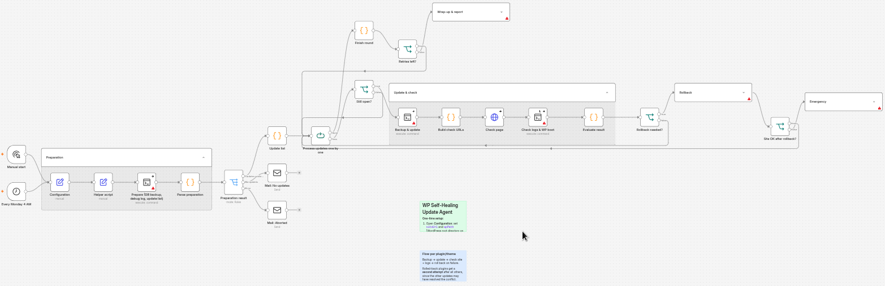

# WP Self-Healing Update Agent for n8n

An n8n workflow that updates WordPress plugins and themes **one at a time**, checks the site after every single update, and **rolls back automatically** if something breaks. You get an HTML report by email, including an AI analysis of what went wrong.

Built for people who manage WordPress sites and are tired of "update all, hope for the best".



## What it does

For every plugin and theme with an available update:

1. **Backup** the plugin/theme folder (plus one database dump before the run starts)
2. **Update** it via WP-CLI
3. **Check** the site:
   - HTTP status of configurable pages (default `/` and `/wp-login.php`)
   - WordPress error page detection (English and German)
   - Does WordPress still boot? (`wp eval` via WP-CLI)
   - **New** fatal errors in the debug log (errors that existed before the run are ignored)
4. **Roll back** from the backup if any check fails
5. **Retry** rolled-back items once more after all other updates, since a conflict may have been resolved by another update

At the end you get one email report: what was updated, what was rolled back, warnings, and an AI explanation (via Groq, swappable for any n8n chat model) of each failure with a concrete next step.

If a rollback itself fails, the workflow stops all further updates and sends an **emergency email** with recovery instructions.

## Safety features

- Runs a **baseline check before touching anything**. If the site is already broken, nothing is updated.
- **Lock file** prevents two runs at the same time
- If `selfheal.sh` is missing on the server, the run stops before changing anything and you get an "aborted" email
- Debug logging is switched on only for the run and restored afterwards, even if a previous run crashed
- Rollback only deletes paths inside `/plugins/` or `/themes/`
- Backups are kept for a configurable number of days (default 14)

## Tested on a live site

Both paths were tested on a production WordPress site (WP 6.9, PHP 7.4, shared hosting):

- **Normal run:** 10 plugins and themes updated one by one (including Elementor 4.1 → 4.3), every page check green, report sent. Total runtime about 2 minutes.
- **Rollback run:** an update was deliberately made to crash the site (HTTP 500, PHP fatal error). The agent detected it via the log, WP-CLI boot check and HTTP check, restored the previous version and verified the site was back online. **Downtime: about 4 seconds.** The second attempt failed the same way and was rolled back again.

## Requirements

**n8n:** any recent version with the SSH, Email (SMTP) and LangChain nodes

**Server (where WordPress runs):**
- SSH access with a private key
- `selfheal.sh` from this repository in `~/wp-selfheal/`
- WP-CLI, PHP-CLI, `curl`, `tar`

**Credentials in n8n:**
- SSH (private key)
- SMTP
- Groq API key (free tier is enough; only used when something fails). You can swap the Groq node for OpenAI, Gemini, Anthropic or a local model.

## Setup

1. Copy the helper script to your server (once, and again whenever you update it):

   ```bash
   mkdir -p ~/wp-selfheal
   curl -fsSL https://raw.githubusercontent.com/Christianzimpel/n8n-wp-self-healing-update-agent/main/selfheal.sh -o ~/wp-selfheal/selfheal.sh
   chmod 700 ~/wp-selfheal/selfheal.sh
   ```

   Or upload `selfheal.sh` by SFTP to `~/wp-selfheal/selfheal.sh`. Please read the script before running it on your server.
2. Import `wp-self-healing-update-agent.json` into n8n
3. Open the **Configuration** node and set:

   | Field | Meaning |
   |---|---|
   | `siteUrl` | Public URL of the site, e.g. `https://www.example.com` |
   | `wpPath` | WordPress root directory on the server |
   | `wpCli` | WP-CLI command, usually `wp` |
   | `checkPaths` | Comma-separated paths to check after each update |
   | `phpErrorLog` | Optional: path to the server's PHP error log |
   | `mailTo` / `mailFrom` | Report recipient and sender |
   | `keepDays` | How long backups are kept on the server |
   | `maxAttempts` | Attempts per plugin/theme (default 2) |

4. Select your SSH credential in all 6 SSH nodes, plus SMTP and Groq credentials
5. **Run it manually against a staging site first**
6. Publish the workflow. It runs every Monday at 4 AM by default.

Backups, the database dump and the debug log of each run are stored on the server in `~/wp-selfheal/runs/<run-id>`.

## How it works

A small bash helper script (`selfheal.sh`, in this repository) lives on the server. The workflow checks that it exists and calls it over SSH with one command per step (`prepare`, `update`, `check`, `rollback`, `finish`). The script returns JSON, which n8n evaluates. This keeps the decision logic visible in n8n.

```
Prepare → for each update: Backup & update → Check pages + logs → Rollback if broken
        → Retry rolled-back items once → Clean up → AI analysis → Email report
```

## Limitations

- A rollback restores **files only**. If a plugin already migrated the database during its update, use the `db-before.sql.gz` dump from the run folder.
- Checks run from the server (WP-CLI) and from n8n (HTTP). Pages behind a login are not checked.
- Built for single-site installations. Multisite is untested.

## License

MIT
